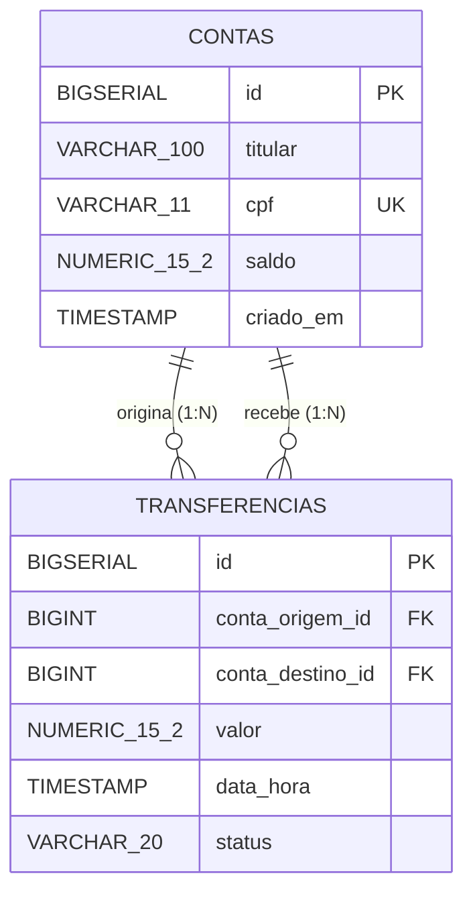
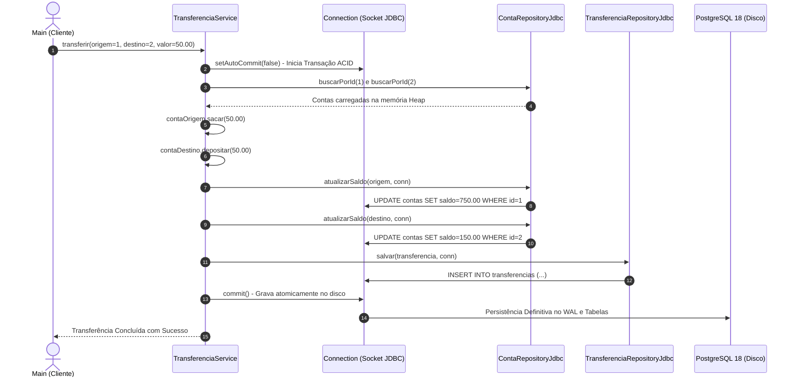

# 🏛️ TransactCore-Java — Motor Transacional & Ledger Bancário 

<p align="left">
  
  
  
  
  
  
</p>

---

## ⚡ O Motor Transacional em Ação

> ### 💳 Quer ver a integridade contábil ACID funcionando no console?
> O **TransactCore-Java** foi desenhado para operar como o núcleo (*ledger*) de uma instituição bancária real (estilo Nubank), processando transferências atômicas via **Raw JDBC** com garantia absoluta de **Tudo ou Nada** no PostgreSQL 18:
>
> ```text
> =====================================================
>    TRANSACTCORE-JAVA: MOTOR TRANSACIONAL BANCARIO    
> =====================================================
> 
> --- ESTADO INICIAL DAS CONTAS NO BANCO ---
> [INFO] Origem: Marcel Florentino | Saldo Atual: R$ 800.00
> [INFO] Destino: Hugo Leonardo | Saldo Atual: R$ 100.00
> 
> --- TESTE 1: EXECUTANDO TRANSFERENCIA ATOMICA COM SUCESSO ---
> [INFO] Saldo da conta ID 1 atualizado para R$ 750.00 com sucesso.
> [INFO] Saldo da conta ID 2 atualizado para R$ 150.00 com sucesso.
> [INFO] Transferencia registrada com sucesso no banco.
> [SUCCESS] Transferencia de R$ 50.00 concluida com sucesso e persistida no banco (COMMIT).
> 
> --- ESTADO DAS CONTAS APOS A TRANSFERENCIA (GRAVADO NO POSTGRESQL) ---
> [INFO] Marcel Florentino | Novo Saldo: R$ 750.00
> [INFO] Hugo Leonardo | Novo Saldo: R$ 150.00
> 
> --- TESTE 2: TENTATIVA DE TRANSFERENCIA SEM SALDO SUFICIENTE (ROLLBACK) ---
> [INFO] Tentando transferir R$ 50000.00 da conta de Marcel Florentino...
> [ROLLBACK] Falha na operacao bancaria. Transacao cancelada e revertida: Saldo insuficiente para realizar o saque
> [SUCCESS] Protecao Ativada com Sucesso! Excecao capturada: Transacao abortada: Saldo insuficiente para realizar o saque
> 
> --- ESTADO FINAL DAS CONTAS (INTEGRIDADE TOTAL GARANTIDA) ---
> [INFO] Marcel Florentino | Saldo Intacto: R$ 750.00
> [INFO] Hugo Leonardo | Saldo Intacto: R$ 150.00
> 
> [SUCCESS] Todos os testes de transacao ACID validados com exito.
> ```

---

## 📌 Sobre o Projeto & Minha Jornada de Engenharia

> 👋 Olá! Meu nome é **Marcel Florentino**, sou desenvolvedor de software apaixonado pela física da computação, arquitetura limpa e engenharia de sistemas de alta precisão.
>
> Vindo dos meus estudos aprofundados de sistemas em C/C++ e C# (.NET), meu objetivo ao conceber o **TransactCore-Java** foi **rejeitar as "mágicas" de frameworks pesados** como Spring Boot ou Hibernate. Eu queria entender a fundo como os dados viajam fisicamente: da alocação de ponteiros na memória Heap, passando pela serialização de sockets TCP via JDBC puro, até a gravação em disco rígido no PostgreSQL 18.
>
> Este repositório é o resultado de uma semana de engenharia profunda, implementando desde o design de tipos monetários arbitrários (`BigDecimal`) até a orquestração transacional de **ACID puro** com controle de conexões compartilhadas e reversão em cascata (`rollback`).

---

## 📑 Hub de Documentação Técnica & Modelagem

Este projeto conta com um dossiê técnico completo e diagramas no padrão OMG UML e DBML:

| Seção de Documentação | Conteúdo Detalhado | Link de Acesso |
| :--- | :--- | :---: |
| **Modelagem do Banco de Dados** | Diagrama ERD, Especificação DBML, Scripts SQL DDL e Índices do PostgreSQL 18. | [🗄️ Ver Engenharia de Dados](./docs/database/README.md) |
| **Modelagem UML Completa** | Diagramas de Classes, Diagramas de Sequência ACID e Arquitetura em Camadas. | [📐 Ver Diagramas UML](./docs/uml/README.md) |
| **Dossiê de Aprendizados & Arquitetura** | Rastro dos Dados, Heap vs Stack, Morte do IEEE 754, Fail-Fast e Transações. | [📖 Acessar Dossiê](./docs/APRENDIZADOS_E_ARQUITETURA.md) |
| **Catálogo de Exemplos de Teste** | 6 cenários práticos e verbosos comentados passo a passo para testes manuais. | [🧪 Ver Catálogo de Testes](./EXEMPLOS_DE_TESTES.md) |

---

## 🧠 Decisões Arquiteturais & Trade-offs de Engenharia

Como arquiteto do sistema, cada linha e tecnologia foi adotada sob critérios rigorosos de computação:

### 1. Por que Raw JDBC (`java.sql`) e NÃO Hibernate / Spring Data?
* **Zero Overhead de Abstração:** Frameworks ORM modernos introduzem dezenas de camadas intermediárias (caching de primeiro e segundo nível, proxy dinâmico em tempo de execução, dirty checking). Em aplicações bancárias de missão crítica onde cada microssegundo conta, o controle fino do JDBC direto permite atingir a máxima vazão de I/O de rede.
* **Transparência Transacional:** Em ORMs, anotações como `@Transactional` mascaram como a conexão é aberta e fechada. No **TransactCore**, o ciclo de vida transacional é explícito via `conn.setAutoCommit(false)`, `conn.commit()` e `conn.rollback()`.

### 2. A Morte do IEEE 754: Por que `NUMERIC(15,2)` e `BigDecimal`?
* Tipos primitivos como `float` e `double` sofrem de imprecisão binária de representação fracionária (a clássica soma `0.1 + 0.2 = 0.30000000000000004`).
* Adotamos `NUMERIC(15,2)` no PostgreSQL e `java.math.BigDecimal` no Java. Ambos calculam com precisão arbitrária exata em base 10, protegendo cada centavo transacionado contra perdas fracionárias.

### 3. Isolamento Corporativo: O Banimento do Schema `public`
* É uma prática amadora manter tabelas de produção dentro do schema padrão `public`.
* O **TransactCore** isola o domínio dentro do schema `financeiro`, configurado diretamente na URL JDBC:  
  `jdbc:postgresql://localhost:5432/transactcore_db?currentSchema=financeiro`.

---

## 🏛️ Modelagem Visual da Aplicação

### 1. Diagrama Entidade-Relacionamento do Banco (Mermaid)



### 2. Diagrama de Sequência: O Rastro Transacional do Pix



---

## 🚀 Como Executar o Projeto Localmente

### Pré-requisitos
* **Java Development Kit (JDK 25 ou superior)**
* **Apache Maven 3.9+**
* **PostgreSQL 18** ativo localmente na porta padrão `5432`

### Passo a Passo

1. **Clone o repositório:**
   ```bash
   git clone https://github.com/applephoria/TransactCore-Java.git
   cd TransactCore-Java
   ```

2. **Crie o Banco e as Tabelas no PostgreSQL:**
   Abra a Query Tool no **pgAdmin 4** ou execute via `psql`:
   Execute o script DDL completo versionado em [`docs/database/README.md`](./docs/database/README.md).

3. **Compile o projeto:**
   * **Via Maven:**
     ```bash
     mvn clean compile
     ```
   * **Ou via `javac` nativo (com o driver PostgreSQL):**
     ```bash
     javac -d target/classes -cp "target/classes;lib/*" src/main/java/com/transactcore/model/*.java src/main/java/com/transactcore/infra/*.java src/main/java/com/transactcore/repository/*.java src/main/java/com/transactcore/service/*.java src/main/java/*.java
     ```

4. **Execute o motor bancário:**
   * **Via Maven:**
     ```bash
     mvn exec:java -Dexec.mainClass="Main"
     ```
   * **Ou via `java` nativo:**
     ```bash
     java -cp "target/classes;lib/postgresql.jar" Main
     ```

---

## 📂 Árvore de Diretórios

```text
TransactCore-Java/
├── docs/
│   ├── APRENDIZADOS_E_ARQUITETURA.md  # Dossiê de Ciência da Computação
│   ├── database/                      # Engenharia de Dados (ERD, DBML, DDL)
│   │   └── README.md
│   └── uml/                           # Diagramas UML (Classes, Sequência, Camadas)
│       ├── README.md
│       ├── arquitetura_camadas.md
│       ├── diagrama_classes.md
│       └── diagrama_sequencia.md
├── src/
│   └── main/
│       └── java/
│           ├── Main.java              # Ponto de Entrada e Testes de ACID
│           └── com/
│               └── transactcore/
│                   ├── infra/         # Fábrica de Conexão JDBC Socket
│                   │   └── DatabaseConnection.java
│                   ├── model/         # Entidades de Domínio e Invariantes
│                   │   ├── Conta.java
│                   │   └── Transferencia.java
│                   ├── repository/    # Contratos e Implementações de Persistência
│                   │   ├── ContaRepository.java
│                   │   ├── ContaRepositoryJdbc.java
│                   │   ├── TransferenciaRepository.java
│                   │   └── TransferenciaRepositoryJdbc.java
│                   └── service/       # Orquestrador Transacional ACID
│                       └── TransferenciaService.java
├── EXEMPLOS_DE_TESTES.md              # Catálogo com 6 cenários práticos
├── pom.xml                            # Manifesto Maven e Dependências
└── README.md                          # Documentação Oficial de Apresentação
```

---

#  Tools and references used:

<p align="left">
  
  
  
  
  
  
  
</p>

---

## 💬 Citações que Inspiram Minha Engenharia

> *"A simplicidade é pré-requisito para a confiabilidade."*  
> — **Edsger W. Dijkstra**

> *"Qualquer tolo pode escrever código que um computador entenda. Bons programadores escrevem código que humanos podem entender."*  
> — **Martin Fowler**

> *"Otimização prematura é a raiz de todos os males."*  
> — **Donald E. Knuth**

> *"Chamo isso de meu erro de um bilhão de dólares... a invenção do ponteiro nulo em 1965."*  
> — **Sir Tony Hoare**

---

# 🙋‍♂️ Connect with me 

<table>
  <tr>
    <a target="_blank" href="https://beacons.ai/applephoria/aboutme"></a>
    <a href="https://www.linkedin.com/in/marcelflorentino/"></a>
    <a href="https://www.instagram.com/applephoria/" target="_blank"></a>
    <a href="mailto:eumarcelflorentino@gmail.com"></a>
  </tr> 
</table>
