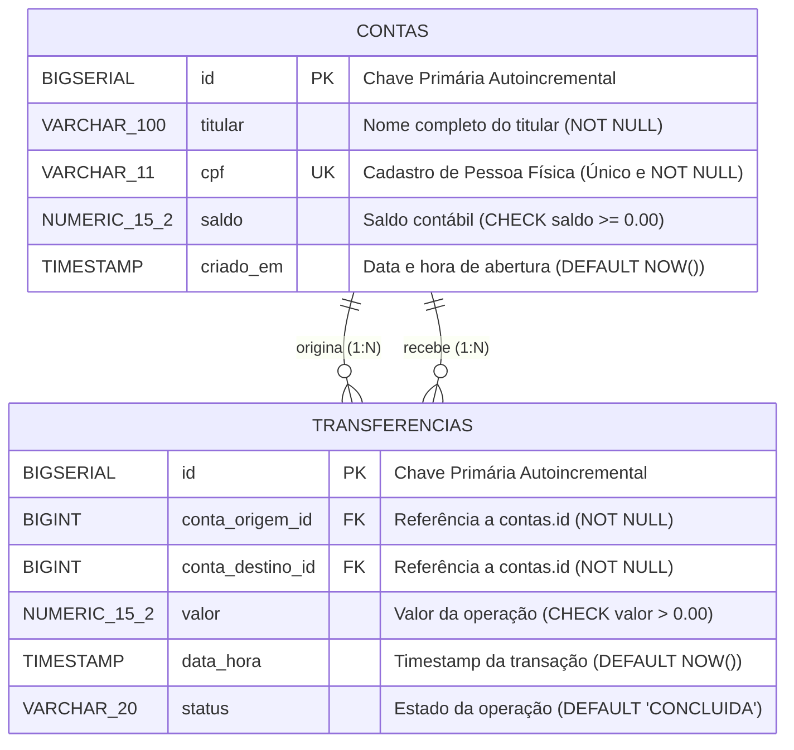

# 🗄️ Modelagem Relacional & Engenharia de Dados (PostgreSQL 18)

> **Autor:** Marcel Florentino ([@applephoria](https://github.com/applephoria))  
> **SGBD Alvo:** PostgreSQL 18  
> **Schema Dedicado:** `financeiro` (Isolamento total com proibição do schema `public`)

---

## 🏛️ 1. Diagrama Entidade-Relacionamento (ERD / Mermaid)

O modelo relacional do **TransactCore-Java** foi concebido sob princípios rigorosos de integridade referencial, normalização contábil (3FN) e imutabilidade de registros de auditoria:



---

## 📐 2. Código DBML (Database Markup Language)

Para visualização interativa e documentação agnóstica de banco de dados no [dbdiagram.io](https://dbdiagram.io), utilize a especificação DBML oficial abaixo:

```dbml
// =========================================================================
// TRANSACTCORE-JAVA: ESPECIFICAÇÃO DE DADOS AGNOSTICA (DBML)
// Autor: Marcel Florentino (@applephoria)
// =========================================================================

TableGroup ledger_core {
  financeiro.contas
  financeiro.transferencias
}

Table financeiro.contas {
  id bigserial [pk, increment, note: 'Identificador único sequencial de 64 bits']
  titular varchar(100) [not null, note: 'Nome do titular da conta']
  cpf varchar(11) [unique, not null, note: 'Documento nacional de identificação (apenas dígitos)']
  saldo numeric(15,2) [not null, default: 0.00, note: 'Saldo líquido contábil. Restrição: saldo >= 0.00']
  criado_em timestamp [default: `CURRENT_TIMESTAMP`, note: 'Carimbo temporal de abertura da conta']

  Note: 'Tabela mestre de clientes e saldos patrimoniais'
}

Table financeiro.transferencias {
  id bigserial [pk, increment, note: 'Identificador único contábil']
  conta_origem_id bigint [not null, note: 'Chave estrangeira apontando para a conta debitada']
  conta_destino_id bigint [not null, note: 'Chave estrangeira apontando para a conta creditada']
  valor numeric(15,2) [not null, note: 'Montante transacionado. Restrição: valor > 0.00']
  data_hora timestamp [default: `CURRENT_TIMESTAMP`, note: 'Registro temporal exato do commit transacional']
  status varchar(20) [default: 'CONCLUIDA', note: 'Estado contábil da liquidação (CONCLUIDA, FALHA, CANCELADA)']

  Note: 'Ledger imutável de movimentações financeiras auditáveis'
}

Ref: financeiro.transferencias.conta_origem_id > financeiro.contas.id [delete: restrict, update: cascade]
Ref: financeiro.transferencias.conta_destino_id > financeiro.contas.id [delete: restrict, update: cascade]
```

---

## 📜 3. Script SQL DDL de Produção (PostgreSQL 18)

Este é o script SQL exato executado na concepção do banco de dados `transactcore_db`:

```sql
-- ============================================================================
-- TRANSACTCORE-JAVA: DDL OFICIAL DO BANCO DE DADOS
-- Autor: Marcel Florentino (@applephoria)
-- ============================================================================

-- 1. Criação do Banco de Dados:
-- CREATE DATABASE transactcore_db;

-- 2. Isolamento de Domínio Corporativo (Banimento do schema public):
CREATE SCHEMA IF NOT EXISTS financeiro;

-- 3. Tabela de Contas:
CREATE TABLE IF NOT EXISTS financeiro.contas (
    id BIGSERIAL PRIMARY KEY,
    titular VARCHAR(100) NOT NULL,
    cpf VARCHAR(11) NOT NULL UNIQUE,
    saldo NUMERIC(15,2) NOT NULL DEFAULT 0.00,
    criado_em TIMESTAMP NOT NULL DEFAULT CURRENT_TIMESTAMP,
    CONSTRAINT chk_saldo_positivo CHECK (saldo >= 0.00)
);

-- 4. Tabela de Transferências (Ledger Contábil):
CREATE TABLE IF NOT EXISTS financeiro.transferencias (
    id BIGSERIAL PRIMARY KEY,
    conta_origem_id BIGINT NOT NULL,
    conta_destino_id BIGINT NOT NULL,
    valor NUMERIC(15,2) NOT NULL,
    data_hora TIMESTAMP NOT NULL DEFAULT CURRENT_TIMESTAMP,
    status VARCHAR(20) NOT NULL DEFAULT 'CONCLUIDA',
    CONSTRAINT fk_transferencia_origem FOREIGN KEY (conta_origem_id) 
        REFERENCES financeiro.contas(id) ON DELETE RESTRICT ON UPDATE CASCADE,
    CONSTRAINT fk_transferencia_destino FOREIGN KEY (conta_destino_id) 
        REFERENCES financeiro.contas(id) ON DELETE RESTRICT ON UPDATE CASCADE,
    CONSTRAINT chk_valor_positivo CHECK (valor > 0.00),
    CONSTRAINT chk_contas_distintas CHECK (conta_origem_id <> conta_destino_id)
);

-- 5. Índices de Alta Performance:
CREATE INDEX IF NOT EXISTS idx_contas_cpf ON financeiro.contas(cpf);
CREATE INDEX IF NOT EXISTS idx_transferencias_origem ON financeiro.transferencias(conta_origem_id);
CREATE INDEX IF NOT EXISTS idx_transferencias_destino ON financeiro.transferencias(conta_destino_id);
CREATE INDEX IF NOT EXISTS idx_transferencias_data ON financeiro.transferencias(data_hora);
```

---

## 🧠 4. Decisões de Engenharia & Ciência da Computação

### A. O Banimento do Schema `public`
No padrão corporativo internacional, nunca se despejam tabelas no schema padrão `public`. 
* **Segurança e Multitenancy:** Criar o schema `financeiro` isola os dados de cobrança e auditoria de outros futuros módulos (como `auth`, `notificacoes` ou `marketing`).
* **Conexão Direcionada:** A URL JDBC fixa o schema ativo via parâmetro: `jdbc:postgresql://localhost:5432/transactcore_db?currentSchema=financeiro`, garantindo portabilidade entre instâncias de teste e homologação.

### B. Por que `NUMERIC(15,2)` e NUNCA `float` ou `double`?
* **A Falha do IEEE 754:** Tipos como `float` e `double` armazenam números com representação binária aproximada em ponto flutuante. Fazer cálculos sucessivos como `0.1 + 0.2` resulta em `0.30000000000000004`, o que geraria sumiço ou criação inexplicável de centavos em um razão contábil.
* **Precisão Arbitrária:** `NUMERIC(15,2)` armazena os dígitos em base 10 pura no disco. São 13 dígitos inteiros e 2 casas decimais exatas, mapeadas diretamente para `java.math.BigDecimal` no Java.

### C. Por que CPF é `VARCHAR(11)` e NUNCA `INT` ou `BIGINT`?
1. **A Física do Zero à Esquerda:** O número `01234567890` se fosse armazenado como número inteiro viraria `1234567890`, corrompendo o documento fiscal.
2. **A Semântica dos Tipos:** Números só devem ser tipados como numéricos se fizer sentido somá-los, subtraí-los ou calculá-los. Ninguém soma o CPF de duas pessoas. O CPF é uma chave de identificação alfanumérica representada por caracteres.

### D. A Robustez do `BIGSERIAL`
`BIGSERIAL` é um açúcar sintático do PostgreSQL que cria nos bastidores um tipo inteiro de 64 bits (`BIGINT`) acoplado a um gerador de sequência (`SEQUENCE`). Isso garante que a base possa processar até **9.223.372.036.854.775.807** registros sem risco de estouro de chave primária.
