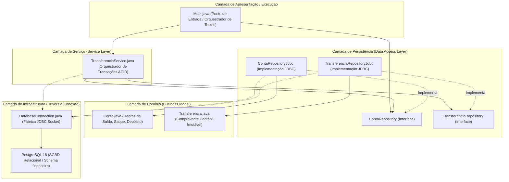

# 🏛️ Arquitetura em Camadas (Separation of Concerns)

> **Autor:** Marcel Florentino ([@applephoria](https://github.com/applephoria))  
> **Tema:** O Fluxo Unidirecional de Dependências e Desacoplamento

---

## 🏗️ Visão Arquitetural

O **TransactCore-Java** foi construído sob uma arquitetura desacoplada em 5 camadas lógicas estritas, onde o domínio e os contratos são o centro de gravidade do sistema:

---

## 📋 Responsabilidade de Cada Camada

| Camada | Pacote Java | Responsabilidade Primária | O que NÃO faz |
| :--- | :--- | :--- | :--- |
| **Apresentação** | `(default / raiz)` | Inicializar cenários de teste, exibir telemetria no console e chamar serviços. | Não escreve SQL e não muta saldos diretamente. |
| **Serviço** | `com.transactcore.service` | Garantir a atomicidade das transferências, orquestrar `commit` e `rollback`, e controlar o ciclo transacional. | Não conhece detalhes de sintaxe SQL ou queries JDBC. |
| **Repositório** | `com.transactcore.repository` | Executar instruções SQL (`INSERT`, `SELECT`, `UPDATE`), mapear `ResultSet` para entidades e gerenciar `PreparedStatements`. | Não decide regras de negócio sobre quando fazer commit ou rollback. |
| **Domínio** | `com.transactcore.model` | Guardar o estado das entidades com encapsulamento estrito (`private`), executar cálculos contábeis e validar invariantes com Fail-Fast. | Não tem nenhuma dependência de bibliotecas de banco ou SQL (`java.sql`). |
| **Infraestrutura** | `com.transactcore.infra` | Configurar o driver JDBC, credenciais seguras e fornecer sockets de rede ativos para o banco. | Não manipula dados de contas ou regras financeiras. |
