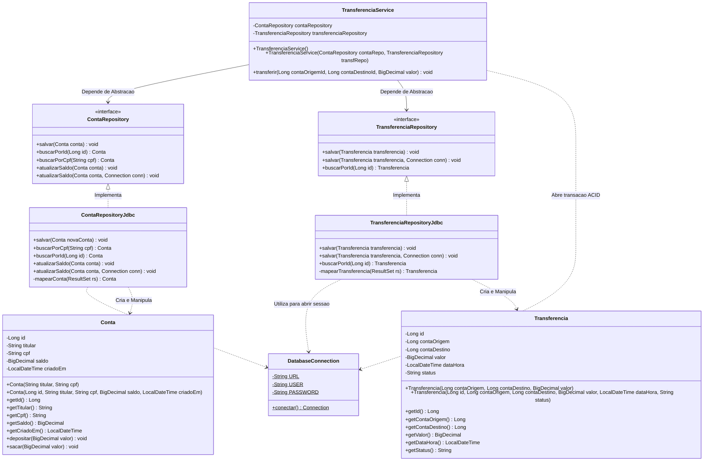

# 📐 Diagrama Estrutural de Classes (UML)

> **Autor:** Marcel Florentino ([@applephoria](https://github.com/applephoria))  
> **Padrão:** Especificação OMG UML 2.5 / Mermaid

---

## 🏛️ Visão Estrutural de Classes e Interfaces

O diagrama abaixo ilustra o desacoplamento de responsabilidades entre o Domínio (`model`), as Interfaces e Implementações de Acesso a Dados (`repository`), a Camada Transacional (`service`) e a Conexão Física (`infra`):

