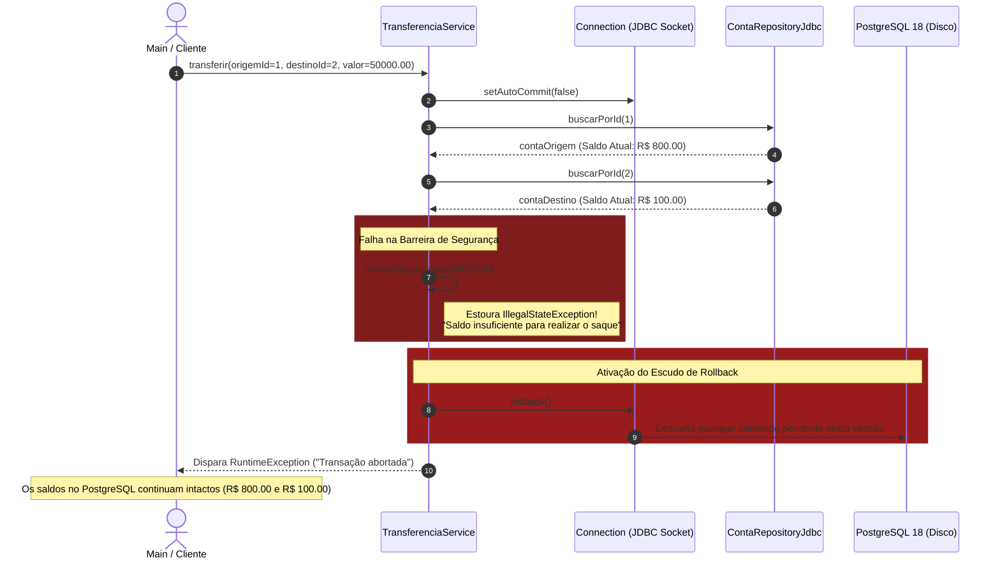

# ⏱️ Diagrama de Sequência & Ciclo de Vida Transacional (UML)

> **Autor:** Marcel Florentino ([@applephoria](https://github.com/applephoria))  
> **Tema:** O Rastro dos Dados e a Garantia de Atomicidade (ACID)

---

## 💸 Cenário 1: Transferência Pix Bem-Sucedida (COMMIT Transacional)

Este diagrama mapeia o ciclo de vida completo de uma transferência válida. Demonstra como uma única `Connection` física do JDBC orquestra as leituras, alterações na Heap, persistência no banco e o `commit` final no disco rígido do PostgreSQL:

```mermaid
sequenceDiagram
    autonumber
    actor Caller as Main / Cliente
    participant Service as TransferenciaService
    participant DB as DatabaseConnection
    participant Conn as Connection (JDBC Socket)
    participant CRepo as ContaRepositoryJdbc
    participant TRepo as TransferenciaRepositoryJdbc
    participant Disk as PostgreSQL 18 (Disco)

    Caller->>Service: transferir(origemId=1, destinoId=2, valor=100.00)
    Service->>Service: Validar Fail-Fast (IDs nulos? valor > 0?)
    
    Service->>DB: conectar()
    DB-->>Service: conn (Sessao TCP ativa)
    
    rect rgb(20, 26, 36)
        Note over Service,Conn: Ativação do Escudo ACID
        Service->>Conn: setAutoCommit(false)
    end

    Service->>CRepo: buscarPorId(1)
    CRepo->>Disk: SELECT * FROM contas WHERE id=1
    Disk-->>CRepo: ResultSet (Conta Origem)
    CRepo-->>Service: contaOrigem (Saldo: R$ 900.00)

    Service->>CRepo: buscarPorId(2)
    CRepo->>Disk: SELECT * FROM contas WHERE id=2
    Disk-->>CRepo: ResultSet (Conta Destino)
    CRepo-->>Service: contaDestino (Saldo: R$ 0.00)

    rect rgb(30, 41, 59)
        Note over Service: Operações na Memória RAM (Heap)
        Service->>Service: contaOrigem.sacar(100.00) -> Novo saldo: 800.00
        Service->>Service: contaDestino.depositar(100.00) -> Novo saldo: 100.00
    end

    Service->>CRepo: atualizarSaldo(contaOrigem, conn)
    CRepo->>Conn: PreparedStatement UPDATE contas SET saldo=800.00 WHERE id=1
    Conn->>Disk: Executa UPDATE na transação ativa

    Service->>CRepo: atualizarSaldo(contaDestino, conn)
    CRepo->>Conn: PreparedStatement UPDATE contas SET saldo=100.00 WHERE id=2
    Conn->>Disk: Executa UPDATE na transação ativa

    Service->>TRepo: salvar(transferencia, conn)
    TRepo->>Conn: PreparedStatement INSERT INTO transferencias (...)
    Conn->>Disk: Executa INSERT na transação ativa

    rect rgb(22, 101, 52)
        Note over Service,Disk: Carimbo Definitivo no Disco (ACID Commit)
        Service->>Conn: commit()
        Conn->>Disk: Grava todas as operações definitivamente no WAL e tabelas
    end

    Service-->>Caller: Transferência Concluída com Sucesso
```

---

## 🛡️ Cenário 2: Proteção Contra Saldo Insuficiente (ROLLBACK Atômico)

Demonstra a barreira de segurança quando uma conta tenta transferir um valor superior ao seu saldo disponível, provando como o `rollback()` restaura o estado anterior e impede que qualquer centavo seja debitado ou gravado:

